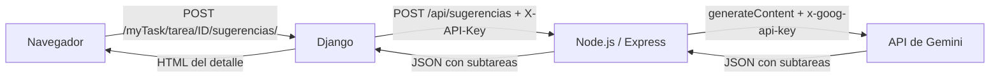

# MyTask — Arquitectura e implementación de la Entrega 3

Documento técnico detallado de cómo se construyó la comunicación entre Django y Node.js, la integración con IA generativa (Gemini), el levantamiento con Docker Compose y el despliegue en Render.

> Estado: implementado y probado. Pruebas automáticas: **47 en Django** y **47 en Node**. Prueba real con Gemini: `gemini-3.5-flash-lite`, HTTP 200 y 4 subtareas.

---

## 1. Visión general

La aplicación tiene **dos servicios** que se comunican por HTTP:



**Idea clave:** Django **nunca** llama a Gemini. Django solo llama al microservicio Node. La clave de Gemini vive únicamente en Node, por lo que nunca se expone en la aplicación web ni llega al navegador.

### Responsabilidades

| Servicio | Responsabilidad | Tecnología | Puerto local |
|---|---|---|---|
| `web` | Interfaz, autenticación, roles, CRUD y bitácora | Django 6.1 + Gunicorn + WhiteNoise | 8000 |
| `sugerencias` | API REST que genera subtareas con IA | Node.js 20 + Express | 3000 |
| externo | Generación de subtareas | Gemini (`gemini-3.5-flash-lite`) | — |

### Archivos principales

| Archivo | Función |
|---|---|
| `MyTask/sugerencias.py` | Cliente HTTP de Django hacia Node. |
| `MyTask/views.py` | Vistas `sugerir_subtareas` y `agregar_sugerencias`. |
| `mysite/settings.py` | Configuración `NODE_SERVICE_URL`, `INTERNAL_API_KEY`, `SUGERENCIAS_TIMEOUT` y carga de `.env`. |
| `microservicio/src/app.js` | API Express: validación, clave interna, endpoints y Swagger. |
| `microservicio/src/gemini.js` | Prompt, llamada a Gemini, reintentos y limpieza de la respuesta. |
| `microservicio/src/server.js` | Arranque del servicio y carga de `.env`. |
| `microservicio/openapi.yaml` | Especificación OpenAPI 3 que alimenta Swagger. |
| `docker-compose.yml` | Define los dos contenedores y el volumen de la base de datos. |
| `Dockerfile` | Imagen de Django. |
| `microservicio/Dockerfile` | Imagen de Node. |
| `.env.example` | Plantilla de variables de entorno (sin valores reales). |

---

## 2. Comunicación Django → Node.js

### 2.1 Configuración

En `mysite/settings.py`:

```python
NODE_SERVICE_URL = os.environ.get('NODE_SERVICE_URL', 'http://localhost:3000')
INTERNAL_API_KEY = os.environ.get('INTERNAL_API_KEY', '')
SUGERENCIAS_TIMEOUT = int(os.environ.get('SUGERENCIAS_TIMEOUT', '60'))
```

| Variable | Significado | Valor según el entorno |
|---|---|---|
| `NODE_SERVICE_URL` | Dónde está Node. | Local: `http://localhost:3000`. Compose: `http://sugerencias:3000`. Render: la URL pública del microservicio. |
| `INTERNAL_API_KEY` | Clave compartida Django ↔ Node. Debe ser **igual en ambos**. | No es la clave de Gemini. |
| `SUGERENCIAS_TIMEOUT` | Tiempo máximo que Django espera a Node. | 60 s por defecto. |
| `GEMINI_API_KEY` | Clave de la API de Gemini. | **Solo en Node.** Django no la conoce. |

Además, `settings.py` carga `.env` automáticamente en local con `os.environ.setdefault`, es decir:

- Si la variable ya viene de Render o Docker, **no la sobrescribe**.
- Si no viene de ningún lado (arranque local normal), la toma de `.env`.

Node hace lo mismo en `server.js` con `process.env[clave] === undefined`.

> Esto se agregó porque antes Django arrancaba sin `.env`, `INTERNAL_API_KEY` llegaba vacía, Node respondía 401 y el usuario veía un mensaje genérico de error.

### 2.2 El cliente HTTP (`MyTask/sugerencias.py`)

La función `pedir_sugerencias(tarea)` hace una petición `POST`:

```python
url = settings.NODE_SERVICE_URL.rstrip('/') + '/api/sugerencias'
peticion = Request(
    url,
    data=json.dumps({
        'titulo': tarea.titulo[:100],
        'descripcion': tarea.descripcion[:1000],
    }).encode('utf-8'),
    headers={
        'Content-Type': 'application/json',
        'X-API-Key': settings.INTERNAL_API_KEY,
    },
    method='POST',
)
```

Puntos importantes:

1. Usa `urllib.request`, **sin dependencias externas nuevas**.
2. Corta el título a 100 caracteres y la descripción a 1000, igual que los límites que valida Node. Así Django nunca envía algo que Node rechazaría por 400.
3. Envía la cabecera `X-API-Key`. Esa es la autenticación entre servicios.
4. Llama a `urlopen(peticion, timeout=settings.SUGERENCIAS_TIMEOUT)`.

### 2.3 Manejo de errores en Django

Django traduce cualquier fallo en la excepción propia `SugerenciasNoDisponibles`, con mensajes en español:

| Situación | Mensaje que ve el usuario |
|---|---|
| Node responde 401, 400, 500… | `El servicio de sugerencias no está disponible en este momento. Intenta de nuevo más tarde.` |
| Node responde 502 con mensaje de la IA | Se reutiliza ese mensaje (por ejemplo, `La IA alcanzó su límite de uso. Intenta de nuevo en un momento.`). |
| Django agota el timeout | `El servicio de sugerencias tardó demasiado en responder. Intenta de nuevo.` |
| Node apagado / sin conexión | `No se pudo conectar con el servicio de sugerencias. Intenta de nuevo más tarde.` |
| JSON inválido o sin `subtareas` | Mensaje genérico. |

Solo se expone al usuario el mensaje del 502, porque es el único que viene de la IA y ya está redactado para usuarios. Los demás errores se registran en logs con `logger.warning`.

La validación final exige que `subtareas` sea una lista de cadenas:

```python
if not isinstance(subtareas, list) or not all(isinstance(s, str) for s in subtareas):
    raise SugerenciasNoDisponibles(MENSAJE_GENERICO)
```

### 2.4 Las vistas de Django

En `MyTask/views.py`:

```python
@login_required
@require_POST
def sugerir_subtareas(request, tarea_id):
    tarea = _tarea_del_usuario(request, tarea_id)
    try:
        sugerencias = pedir_sugerencias(tarea)
    except SugerenciasNoDisponibles as error:
        messages.error(request, str(error))
        sugerencias = []
    return render(request, 'MyTask/detalle.html',
                  _contexto_detalle(tarea, sugerencias=sugerencias))
```

- `@login_required`: solo usuarios con sesión.
- `@require_POST`: la URL solo acepta POST; un GET devuelve 405.
- `_tarea_del_usuario`: verifica que la tarea pertenezca al usuario autenticado (aislamiento de datos).
- Si falla la IA, se muestra `messages.error` y la página **sigue funcionando**; no se rompe.

La segunda vista guarda las sugerencias elegidas:

```python
titulos = [t.strip()[:LARGO_TITULO] for t in request.POST.getlist('sugerencia')]
Tarea.objects.bulk_create(
    [Tarea(propietario=request.user, titulo=titulo) for titulo in titulos]
)
```

Es decir, las sugerencias **no se guardan automáticamente**: el usuario marca las que quiere y se crean tareas normales con `bulk_create`, en una sola consulta.

### 2.5 El servidor Node (`microservicio/src/app.js`)

El endpoint principal:

```javascript
app.post('/api/sugerencias', async (req, res) => {
  if (!clavesIguales(req.get('X-API-Key'), internalApiKey)) {
    return res.status(401).json({ error: 'Clave de API ausente o incorrecta.' });
  }
  const { error, valor } = validar(req.body);
  if (error) return res.status(400).json({ error });
  try {
    const subtareas = await generarTarea(valor);
    return res.json({ tarea: valor.titulo, subtareas });
  } catch (e) {
    const mensaje = e instanceof IAError ? e.message : 'No se pudieron generar las sugerencias.';
    return res.status(502).json({ error: mensaje });
  }
});
```

Orden de las comprobaciones:

1. **Clave** → 401 si falta o está mal.
2. **Validación** → 400 si el título está vacío, mide más de 100 caracteres o la descripción más de 1000.
3. **IA** → 200 con `{ tarea, subtareas }`, o 502 con un mensaje en español.

La comparación de la clave es segura:

```javascript
function clavesIguales(recibida, esperada) {
  const a = crypto.createHash('sha256').update(String(recibida || '')).digest();
  const b = crypto.createHash('sha256').update(String(esperada)).digest();
  return crypto.timingSafeEqual(a, b);
}
```

Se hashlean ambas claves con SHA-256 y se comparan con `timingSafeEqual`, lo que evita ataques de tiempo (*timing attacks*). Nunca se compara la clave en texto plano con `===`.

### 2.6 Endpoints

| Método y ruta | Autenticación | Respuesta |
|---|---|---|
| `GET /health` | Ninguna | `{"estado":"ok"}`. Sirve para verificar el servicio y despertarlo en Render. |
| `GET /api-docs` | Ninguna | Swagger UI público. |
| `GET /openapi.yaml` | Ninguna | Especificación OpenAPI en bruto. |
| `POST /api/sugerencias` | Cabecera `X-API-Key` | 200, 400, 401 o 502, siempre JSON en español. |

Swagger tiene dos formas de enviar la clave: el campo visible **X-API-Key** dentro de *Try it out* y el botón **Authorize** (`ApiKeyAuth`). Si la clave está mal, responde 401.

---

## 3. Integración con IA generativa (Gemini)

### 3.1 Modelo y parámetros

En `microservicio/src/gemini.js`:

```javascript
const MODELO_POR_DEFECTO = 'gemini-3.5-flash-lite';
const MIN_SUBTAREAS = 3;
const MAX_SUBTAREAS = 6;
const MAX_LARGO = 100;
const MAX_INTENTOS = 3;
const ESPERA_BASE_MS = 1000;
const TIMEOUT_INTENTO_MS = 8000;
```

| Parámetro | Valor | Por qué |
|---|---|---|
| Modelo | `gemini-3.5-flash-lite` | Responde rápido y funciona con la cuota gratuita. Se puede cambiar con `GEMINI_MODEL`. |
| Subtareas | entre 3 y 6 | Cumple el requisito funcional. |
| Largo máximo por subtarea | 100 caracteres | Evita texto demasiado largo en la interfaz. |
| Timeout por intento | 8 s | Evita que la petición parezca colgada. |
| Intentos | 3 | Tolera fallos temporales del servicio externo. |
| Esperas | 1 s y 2 s | Retroceso exponencial (*backoff*). |

Tiempo total máximo aproximado: `3 × 8 s + 1 s + 2 s ≈ 27 s`, por debajo de los 60 s que espera Django.

### 3.2 El prompt

```javascript
function construirPrompt({ titulo, descripcion }) {
  const detalle = descripcion ? `\nDescripción: ${descripcion}` : '';
  return (
    'Eres un asistente que ayuda a empezar tareas dividiéndolas en pasos concretos.\n' +
    `Tarea: ${titulo}${detalle}\n\n` +
    `Propón entre 3 y 6 subtareas en español, cortas (máximo 100 caracteres cada una), ` +
    `accionables y en orden.\n` +
    'Responde SOLO con un JSON con esta forma exacta, sin texto adicional: ' +
    '{"subtareas": ["paso 1", "paso 2", "paso 3"]}'
  );
}
```

El prompt pide explícitamente:

- idioma español,
- entre 3 y 6 pasos,
- máximo 100 caracteres por paso,
- acciones concretas y ordenadas,
- **solo JSON**, sin texto adicional.

### 3.3 La llamada a la API

```javascript
const url = `https://generativelanguage.googleapis.com/v1beta/models/${encodeURIComponent(
  model,
)}:generateContent`;

const peticion = {
  method: 'POST',
  headers: { 'Content-Type': 'application/json', 'x-goog-api-key': apiKey },
  body: JSON.stringify({ contents: [{ parts: [{ text: construirPrompt(tarea) }] }] }),
};
```

La clave de Gemini viaja en la cabecera `x-goog-api-key` **desde Node hacia Google**. Django y el navegador nunca la ven.

### 3.4 Reintentos

```javascript
const ESTADOS_REINTENTABLES = new Set([500, 502, 503, 504]);

for (let intento = 1; ; intento += 1) {
  const hayMasIntentos = intento < intentos;
  try {
    respuesta = await fetchImpl(url, {
      ...peticion,
      signal: AbortSignal.timeout(timeoutMs),
    });
  } catch (e) {
    if (hayMasIntentos) {
      await esperar(ESPERA_BASE_MS * 2 ** (intento - 1));
      continue;
    }
    throw new IAError('No se pudo conectar con la IA.');
  }
  if (respuesta.ok) break;
  if (ESTADOS_REINTENTABLES.has(respuesta.status) && hayMasIntentos) {
    await esperar(ESPERA_BASE_MS * 2 ** (intento - 1));
    continue;
  }
  throw new IAError(/* mensaje según el código */);
}
```

| Situación | Acción |
|---|---|
| 500, 502, 503, 504 | Reintentar con espera de 1 s y luego 2 s. |
| Fallo de red o timeout | Reintentar igual. |
| 429 (límite de cuota) | **No** reintentar; mensaje: `La IA alcanzó su límite de uso. Intenta de nuevo en un momento.` |
| 400/401/404 (clave, modelo, solicitud) | **No** reintentar; mensaje: `La IA no está disponible en este momento.` |

### 3.5 Procesamiento de la respuesta

Gemini responde con un objeto JSON anidado. Se extrae el texto:

```javascript
const texto = cuerpo?.candidates?.[0]?.content?.parts?.[0]?.text;
```

Luego `extraerJson` busca la primera `{` y la última `}` para quedarse solo con el JSON, aunque el modelo haya agregado texto alrededor. Si no puede parsearlo, lanza `IAError('La IA no devolvió un formato válido.')`.

Finalmente `limpiar`:

1. Verifica que `subtareas` sea un arreglo.
2. Filtra solo cadenas.
3. Recorta cada una a 100 caracteres y elimina espacios.
4. Descarta las vacías y se queda con máximo 6.
5. Exige al menos 3; si hay menos, lanza `IAError('La IA no devolvió suficientes subtareas.')`.

### 3.6 Resultado verificado

Prueba real ejecutada contra Gemini:

```text
POST /api/sugerencias
HTTP 200
Modelo: gemini-3.5-flash-lite
Subtareas devueltas: 4
Ejemplo: "Definir los casos de uso para la demo"
Tiempo aproximado: 1,3 s
```

La integración Django → Node → Gemini → Django también se verificó de punta a punta, con 4 subtareas mostradas en el detalle de la tarea.

---

## 4. Docker Compose

### 4.1 Qué es

Docker Compose permite levantar **varios contenedores con un solo comando**. En lugar de iniciar Django en una terminal y Node en otra, `docker-compose.yml` describe ambos servicios y sus variables.

### 4.2 Estructura de `docker-compose.yml`

```yaml
services:
  sugerencias:
    build: ./microservicio
    ports:
      - "3000:3000"
    environment:
      GEMINI_API_KEY: ${GEMINI_API_KEY}
      GEMINI_MODEL: ${GEMINI_MODEL:-}
      INTERNAL_API_KEY: ${INTERNAL_API_KEY}

  web:
    build: .
    ports:
      - "8000:8000"
    environment:
      DJANGO_SECRET_KEY: ${DJANGO_SECRET_KEY}
      DJANGO_DEBUG: ${DJANGO_DEBUG:-False}
      DJANGO_ALLOWED_HOSTS: ${DJANGO_ALLOWED_HOSTS:-localhost,127.0.0.1}
      DJANGO_DB_PATH: /data/db.sqlite3
      NODE_SERVICE_URL: http://sugerencias:3000
      INTERNAL_API_KEY: ${INTERNAL_API_KEY}
    volumes:
      - datos:/data
    depends_on:
      - sugerencias

volumes:
  datos:
```

| Elemento | Explicación |
|---|---|
| `build: ./microservicio` | Construye la imagen de Node desde esa carpeta. |
| `build: .` | Construye la imagen de Django desde la raíz. |
| `ports` | Mapea el puerto de la máquina al del contenedor. |
| `${VARIABLE}` | Toma el valor del archivo `.env`. |
| `NODE_SERVICE_URL: http://sugerencias:3000` | Dentro de Docker, Django llama a Node por el **nombre del servicio**, no por `localhost`. |
| `volumes: datos:/data` | Guarda `db.sqlite3` fuera del contenedor para no perderlo al reiniciar. |
| `depends_on` | Indica que Django debe arrancar después de Node. |

> Este es el cambio más importante respecto al arranque local: en local `NODE_SERVICE_URL=http://localhost:3000`; dentro de Compose es `http://sugerencias:3000`.

### 4.3 Imágenes

**`Dockerfile` (Django):**

1. Parte de `python:3.12-slim`.
2. Instala `requirements.txt` primero para aprovechar la caché de capas.
3. Copia el código.
4. Ejecuta `collectstatic` para que WhiteNoise sirva el CSS.
5. Crea `/data` y usa un usuario sin privilegios (`appuser`).
6. En el arranque: aplica migraciones, crea el superusuario si hay variables `DJANGO_SUPERUSER_*` y lanza Gunicorn en el puerto 8000 con 2 workers y timeout de 90 s.

**`microservicio/Dockerfile` (Node):**

1. Parte de `node:20-alpine`.
2. Copia `package.json` y `package-lock.json`, ejecuta `npm ci --omit=dev` (solo dependencias de producción).
3. Copia `src/` y `openapi.yaml`.
4. Usa el usuario `node` (sin privilegios).
5. Arranca con `node src/server.js` en el puerto 3000.

### 4.4 Comandos

```powershell
# 1. Preparar el archivo de variables (solo la primera vez)
copy .env.example .env

# 2. Editar .env con las claves reales

# 3. Construir y levantar
docker compose up --build

# 4. Verificar
# http://localhost:8000/login/
# http://localhost:3000/health
# http://localhost:3000/api-docs

# 5. Ver el estado de los contenedores
docker compose ps

# 6. Apagar (Ctrl + C o este comando)
docker compose down

# 7. Apagar y borrar también la base de datos del volumen
docker compose down -v
```

### 4.5 Errores comunes

| Síntoma | Causa | Solución |
|---|---|---|
| `failed to connect to the docker API at npipe:////./pipe/dockerDesktopLinuxEngine` | Docker Desktop está apagado. | Abrir Docker Desktop desde el menú Inicio y esperar a que arranque. |
| Django muestra “No se pudo conectar con el servicio” | `NODE_SERVICE_URL` apunta a `localhost` dentro del contenedor. | Debe ser `http://sugerencias:3000`. |
| Mensaje genérico de sugerencias | `INTERNAL_API_KEY` distinta en los dos servicios. | Poner exactamente el mismo valor en ambos. |
| Swagger responde 401 | Clave pegada incorrectamente. | Pegar `INTERNAL_API_KEY` en `X-API-Key`, sin comillas ni espacios. |

Verificación real: `docker compose up --build` probado con `/health`, `/login/` y `/api-docs` respondiendo 200.

---

## 5. Despliegue en Render

### 5.1 Qué se publica

Se crean **dos Web Services** en Render, uno por contenedor:

| Servicio | Root Directory | Runtime | URL resultante |
|---|---|---|---|
| Microservicio | `microservicio` | Docker | `https://mytask-sugerencias.onrender.com` |
| Aplicación web | *(vacío)* | Docker | `https://mytask.onrender.com` |

Se crea primero el microservicio porque Django necesita su URL pública para la variable `NODE_SERVICE_URL`.

Ambos servicios despliegan desde la rama `main`, con `Runtime = Docker`, así que Render usa los mismos `Dockerfile` que ya funcionan en local.

### 5.2 Variables de entorno en Render

Render **no lee el `.env` del repositorio**; las variables se escriben una por una en el dashboard de cada servicio.

**Microservicio (`mytask-sugerencias`):**

| Variable | Valor |
|---|---|
| `GEMINI_API_KEY` | Clave nueva de Gemini. |
| `GEMINI_MODEL` | `gemini-3.5-flash-lite` |
| `INTERNAL_API_KEY` | Clave larga inventada; anotarla. |

**Django (`mytask`):**

| Variable | Valor |
|---|---|
| `DJANGO_SECRET_KEY` | Otra clave larga inventada. |
| `DJANGO_DEBUG` | `False` |
| `DJANGO_ALLOWED_HOSTS` | `.onrender.com` |
| `DJANGO_CSRF_TRUSTED_ORIGINS` | `https://*.onrender.com` |
| `NODE_SERVICE_URL` | URL del microservicio, sin `/` al final. |
| `INTERNAL_API_KEY` | **Exactamente la misma** del microservicio. |
| `DJANGO_SUPERUSER_USERNAME` | `admin` |
| `DJANGO_SUPERUSER_PASSWORD` | Contraseña fuerte. |
| `DJANGO_SUPERUSER_EMAIL` | Correo cualquiera. |

El código carga `.env` con `setdefault`, por lo que los valores que ponga Render **ganan** siempre sobre el archivo local.

### 5.3 Flujo en producción

```text
Navegador
   │ POST /myTask/tarea/2/sugerencias/
   ▼
Django (mytask.onrender.com)
   │ POST https://mytask-sugerencias.onrender.com/api/sugerencias
   │ X-API-Key: <INTERNAL_API_KEY>
   ▼
Node (mytask-sugerencias.onrender.com)
   │ POST generativelanguage.googleapis.com/...:generateContent
   │ x-goog-api-key: <GEMINI_API_KEY>
   ▼
Gemini
```

A diferencia de Docker Compose, aquí Django usa la **URL pública HTTPS** de Node. Por eso `NODE_SERVICE_URL` es distinta en cada entorno.

### 5.4 Verificación paso a paso

1. Abrir `https://<microservicio>/health` → `{"estado":"ok"}`.
2. Abrir `https://<microservicio>/api-docs` → Swagger público.
3. En Swagger, *Try it out* en `POST /api/sugerencias`, pegar `INTERNAL_API_KEY` en `X-API-Key` y ejecutar → 200 con subtareas.
4. Abrir la URL de Django, iniciar sesión, crear una tarea y pulsar **Sugerir subtareas** → aparecen las subtareas.
5. Marcar algunas y pulsar **Agregar como tareas** → se crean tareas nuevas.
6. Abrir `/admin/` → comprobar el rol de administrador.

### 5.5 Limitaciones del plan gratuito

| Limitación | Consecuencia | Qué hacer |
|---|---|---|
| Los servicios se duermen tras ~15 min sin visitas. | El primer acceso tarda cerca de 1 minuto. | Antes de grabar o sustentar, abrir `/health` y la página de Django para despertarlos. |
| SQLite es efímero. | Los datos se reinician en cada despliegue. | Volver a crear usuarios y tareas; el administrador se crea solo. |
| Cuota gratuita de Gemini limitada. | Puede aparecer el mensaje de límite de uso. | Esperar e intentar más tarde; la app sigue funcionando. |

Mejora futura: reemplazar SQLite por PostgreSQL para que los datos persistan.

---

## 6. Seguridad

| Medida | Dónde | Detalle |
|---|---|---|
| Clave de Gemini aislada | `microservicio/` | Solo Node la conoce. Nunca se envía a Django ni al navegador. |
| Clave interna compartida | Django y Node | Distinta de la de Gemini; comparada con hash SHA-256 y `timingSafeEqual`. |
| `.env` ignorado | `.gitignore` | Los valores reales no se suben a GitHub; solo `.env.example`. |
| Carga con `setdefault` | `settings.py` y `server.js` | Las variables de Render/Docker no son sobrescritas por `.env`. |
| Mensajes genéricos | `sugerencias.py` | Los errores internos no se exponen al usuario. |
| Validación de tamaño | Django y Node | `express.json({ limit: '10kb' })` y límites de 100/1000 caracteres. |
| Aislamiento por usuario | `views.py` | `_tarea_del_usuario` evita ver o modificar tareas ajenas. |

> La clave de Gemini que se compartió accidentalmente en la conversación debe considerarse comprometida: hay que generar una nueva en <https://aistudio.google.com> y usarla en Render. No pegar claves reales en el código ni en documentos.

---

## 7. Pruebas

| Tipo | Comando | Resultado |
|---|---|---|
| Django | `python manage.py test` | 47 pruebas OK. |
| Node | `npm --prefix microservicio test` | 47 pruebas OK (3 suites). |
| Integración real | `POST /api/sugerencias` con Gemini | HTTP 200, 4 subtareas. |
| Compose | `docker compose up --build` | `/health`, `/login/` y `/api-docs` → 200. |

Las pruebas automáticas **simulan** a Gemini (no gastan cuota); la prueba real se hizo manualmente una sola vez.

---

## 8. Resumen para la sustentación

1. **Comunicación:** Django usa `urllib` para hacer un POST a Node con la cabecera `X-API-Key`; Node valida la clave con `timingSafeEqual`, valida el cuerpo y devuelve JSON en español.
2. **IA:** Node construye un prompt en español, llama a Gemini con `gemini-3.5-flash-lite`, reintenta hasta 3 veces ante fallos temporales, extrae el JSON y limpia entre 3 y 6 subtareas.
3. **Docker Compose:** dos servicios (`web` y `sugerencias`), un volumen para SQLite y una sola orden para levantar todo.
4. **Render:** dos Web Services desde `main` con Runtime Docker; variables configuradas a mano; la URL de Node se pasa a Django como `NODE_SERVICE_URL`.
5. **Robustez:** si la IA falla, se muestra un aviso claro y la aplicación sigue funcionando.
