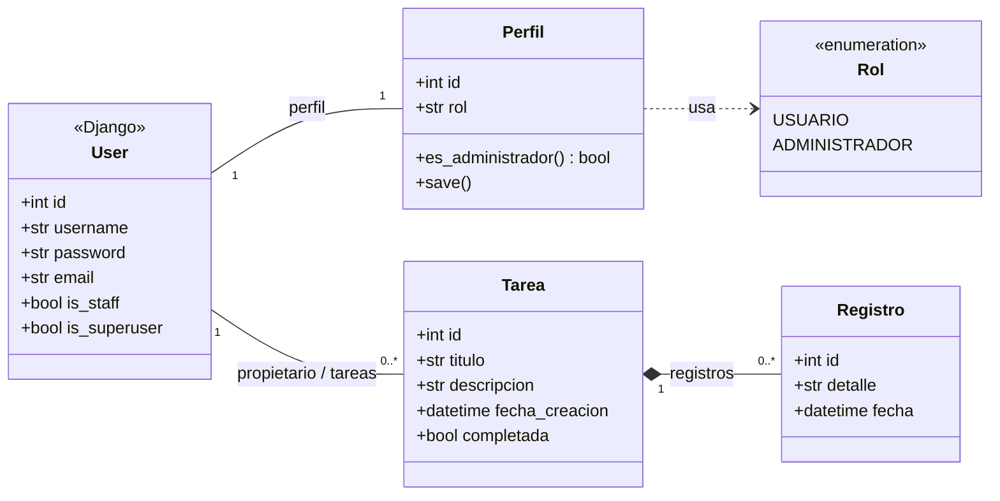
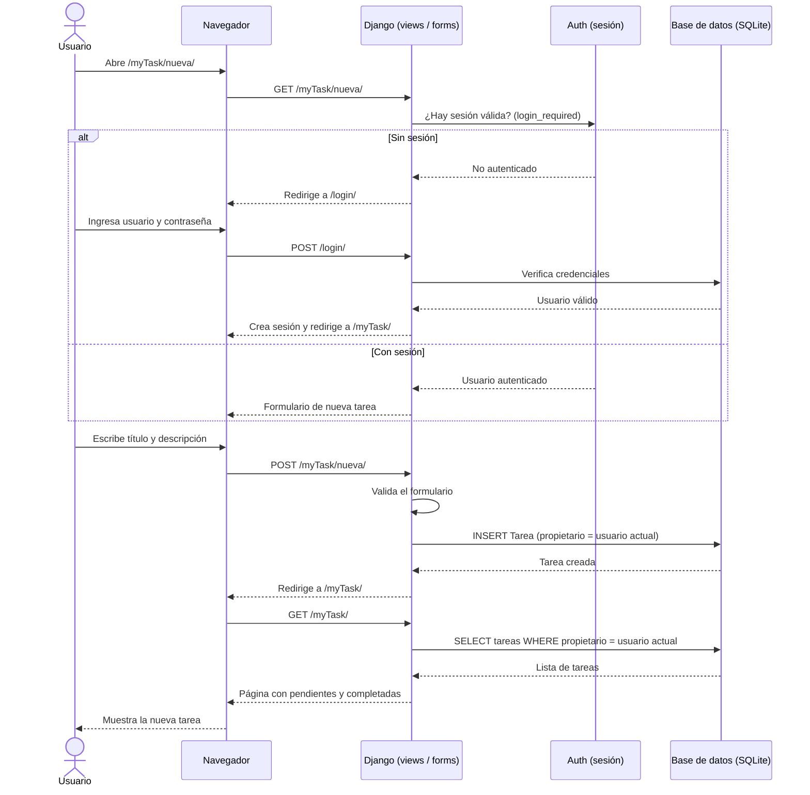
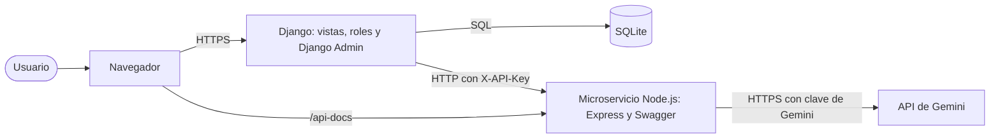
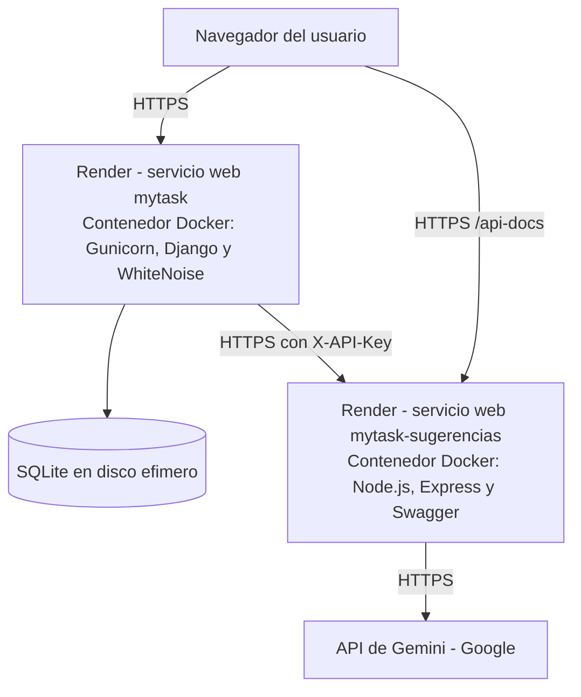
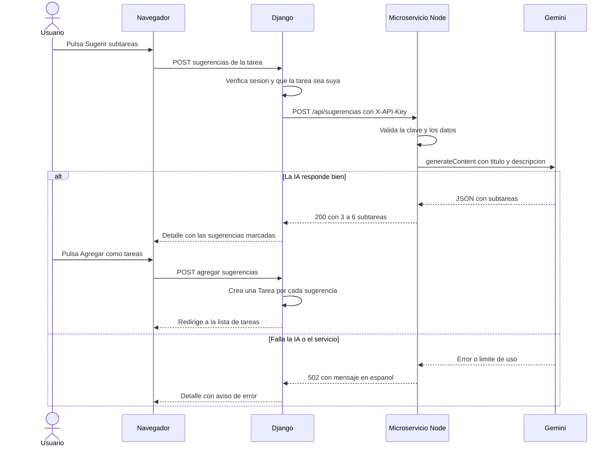

# Diagramas UML — MyTask

Los diagramas están en Mermaid. Se ven directamente en GitHub y en VS Code (extensión *Markdown Preview Mermaid Support*). Para pegarlos en el SRS, ábrelos en <https://mermaid.live> y exporta PNG o SVG. Los PNG ya exportados están en esta carpeta.

## 1. Diagrama de clases (modelos)

`User` es el modelo de autenticación de Django (`django.contrib.auth`); las otras tres clases están en `MyTask/models.py`. Imagen: `diagrama_clases_modelos.png`.

**Reglas de negocio reflejadas en el modelo**

- Un `Perfil` se crea automáticamente al registrar un `User` (señal `post_save`). Los superusuarios nacen como Administrador.
- Al guardar un `Perfil`, el campo `is_staff` del usuario se sincroniza con el rol para dar o quitar acceso a Django Admin.
- Eliminar un `User` elimina su `Perfil` y sus `Tarea` (`CASCADE`); eliminar una `Tarea` elimina sus `Registro`.

## 2. Diagrama de secuencia (primera versión): crear una tarea con sesión iniciada

## 3. Diagrama de componentes (Entrega 3)

## 4. Diagrama de despliegue (Entrega 3)

Con Docker Compose en un computador local son los mismos dos contenedores (`web` y `sugerencias`); en el despliegue público son dos servicios web de Render.

## 5. Diagrama de secuencia: sugerir y agregar subtareas (Entrega 3)

